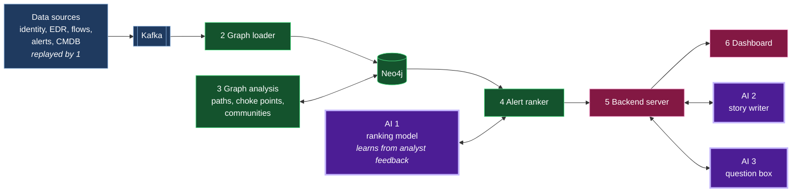

# GraphOps

Graph analytics for security operations centres (SOCs). GraphOps puts an organisation's users, machines, applications, permissions and security alerts into one Neo4j graph so analysts can see how alerts connect, what an attacker can reach next and which access paths are dangerous before an attack happens.

Built by Team Pingu Haters for hackFront India 2026 (Cybersecurity theme).

## Scope

GraphOps focuses on on-premises and hybrid networks: a company's own machines and Active Directory, plus the cloud accounts and services connected to them. Cloud-only tools already rank threats and show blast radius using graph context in the cloud. The gap we target is the company network and the attack paths that cross from it into the cloud.

## Status

Research and planning. No code yet. Features below describe what we are building, not what already works.

## The problem

- **Too much noise.** In the SANS 2025 Detection and Response Survey, 73% of respondents cited false positives as a main detection challenge, the most cited one, up from 64% in 2024. SANS also notes that excessive noise gives attackers cover.
- **Attackers are fast.** CrowdStrike measured an average eCrime breakout time of 29 minutes in 2025, down from 48 minutes in 2024. Breakout time is how long an attacker takes to move from the first compromised machine to others.
- **Breaches are expensive.** IBM puts the average cost of a data breach at USD 4.99 million globally and a record INR 25.5 crore in India (2026).
- **Reporting deadlines are tight.** Under the CERT-In Directions of 28 April 2022, organisations in India must report cyber incidents to CERT-In within 6 hours of noticing them.

## Pain points we tackle

| # | Pain point | What GraphOps does |
|---|---|---|
| 1 | Too many alerts, most of them false | Ranks every alert by where it sits in the graph. No alert is deleted and every rank shows its reasons. |
| 2 | Alerts arrive as separate rows | Links alerts that share a user or machine into one incident, ordered by MITRE ATT&CK stage. |
| 3 | Attackers move faster than analysts | Precomputes each node's distance to critical assets so a new alert is scored instantly. |
| 4 | No quick answer to "how bad is this?" | Shows the 1, 2 and 3 hop blast radius around any alerted node. |
| 5 | Dangerous paths exist before any attack | Maps attack paths from low-trust zones to critical assets and lists the choke points that cut off the most paths. |
| 6 | People hold more access than they use | Draws the blast radius twice: once over granted access and once over access actually used. The difference is the risk that least privilege removes. |
| 7 | Rules check one step at a time | Flags a user reaching a system through a path they have never used before, even when each step looks normal. |

### AI agents as identities

Companies now run AI agents that hold real permissions. GraphOps treats every AI agent as an identity in the same graph as users, so the features above apply to it:

- **Granted vs used access:** "this agent holds 50 permissions and uses 3."
- **Never-taken path:** "this agent just reached the finance database by a route it has never used."
- **Alert ranking:** an alert on an AI agent ranks high when the agent sits close to critical assets.

IBM found that 13% of organisations reported breaches of AI models or applications and 97% of those lacked proper AI access controls (2025). BloodHound Enterprise and XM Cyber already map attack paths through AI agents. Our addition is applying granted vs used access, never-taken paths and alert ranking to them.

## How alerts are ranked

Each alert is scored on six questions answered from the graph:

1. Is it linked to other alerts through the same user or machine within a short time?
2. How many steps is it from a critical asset?
3. How many critical assets sit within 3 hops of it?
4. Is it unusual, such as a first-time action or a never-used path?
5. Do the linked alerts follow attack stages in order?
6. Does it sit on a choke point?

The weight of each question is our design choice. It will be tuned on test data and can learn from analyst feedback.

## Where AI is used

| Part | What it does | Tools | How we keep it honest |
|---|---|---|---|
| 1. Ranking model | Learns how much each of the six ranking questions should count, from analysts marking alerts as real or false | scikit-learn (logistic regression or a decision tree) | Small and explainable. Every score shows which questions pushed it up. |
| 2. Incident story | Drafts a plain-English story of an incident, step by step, from its subgraph | An LLM called through `neo4j-graphrag`, fed only the incident's nodes and edges pulled by a Cypher query | Every sentence must cite graph node IDs. A checker confirms each cited ID exists in the incident. An analyst approves the draft. |
| 3. Plain-English questions | Turns questions such as "what can this laptop reach?" into graph queries | `Text2CypherRetriever` from `neo4j-graphrag` | The generated query is shown to the analyst and runs in a read-only transaction, so it cannot change the graph. |

The LLM provider is still to be chosen.

## How GraphOps differs from existing tools

Existing products each cover part of this list. In our review of Microsoft, Google SecOps, Palo Alto Cortex, Splunk Enterprise Security, CrowdStrike, BloodHound, Wiz and XM Cyber, none covered all seven pain points. None documented points 6 and 7 for on-premises networks.

GraphOps is not a new algorithm. It brings these capabilities into one open, self-hosted Neo4j graph that takes data from any vendor.

## How it works

GraphOps is six programs arranged in layers. Steps 1 to 3 handle data and graph maths. AI is used in steps 4 and 5.

Blue: data and streaming. Green: graph and ranking. Purple: AI. Pink: server and dashboard.

### 1. Live data simulator

We have no real company sending us live security data, so this Python script plays back saved data as if it were happening now.

- It reads saved events in time order, for example "10:42:03, raja logged into server-7".
- It waits the real gap between events, or a shorter gap to run at 10x or 100x speed.
- It sends each event to Kafka, into a topic for its source: logins and permissions to `identity`, programs started to `edr`, network connections to `flows`, security alerts to `alerts` and machine inventory to `cmdb`.

In a real company, the security tools themselves would send events to Kafka and this script would not be needed.

### 2. Graph loader

This Python program listens to the five Kafka topics and turns each event into dots and lines in Neo4j.

- "raja logged into server-7" becomes a user node `raja`, a machine node `server-7` and a `LOGGED_INTO` edge between them.
- If the edge already exists, it updates "last seen". If it is new, it records "first seen". This is how GraphOps later knows a path has never been used before.
- It writes events in batches of a few hundred, which is much faster than one at a time.
- When the event is an alert, it saves the alert as a node linked to the user and machine involved, then tells the alert ranker a new alert has arrived.

### 3. Background graph analysis

This Python script runs every 5 minutes and does the slow calculations ahead of time, so nothing slow happens while an analyst waits.

- It counts how many steps each machine and account is from the nearest critical asset, such as the customer database, and saves that number on the node.
- It finds choke points and saves a choke point score on each node.
- It groups machines that normally work together into communities and saves the group number on each node.

### 4. Alert ranker (uses AI 1)

This Python program scores each new alert the moment it arrives.

1. It answers the six ranking questions. Most answers are already saved on the nodes by step 3, so this takes milliseconds. For example: "server-7 is 2 steps from the customer database" and "server-7 is a choke point".
2. It combines the six answers into one score with the ranking model, a small scikit-learn model that learns from analysts marking alerts as real or false.
3. It looks for other alerts involving the same user or machine in the last few hours and links them into one incident.
4. It saves the score, the reasons and the incident in Neo4j and passes the ranked alert on to the backend server.

### 5. Backend server (hosts AI 2 and AI 3)

A FastAPI web server that sits between the dashboard and the data.

- It answers the dashboard's questions, such as "what is the blast radius of laptop-42?" or "show the attack paths to the customer database", by running Cypher queries on Neo4j.
- It pushes each newly ranked alert to every open dashboard instantly over WebSocket, so the analyst never refreshes the page.
- It hosts the two LLM features:

**Incident story writer.** When the analyst asks for an incident's story:
1. A Cypher query pulls every alert, machine, account and connection in the incident, each with its ID.
2. These facts go to the LLM with one rule: every sentence must cite the ID it is based on.
3. A checker drops any sentence that cites an ID not in the incident, so the LLM cannot invent facts.
4. The analyst sees the draft marked "needs analyst approval".

**Plain-English question box.** When the analyst types "what can laptop-42 reach?":
1. `Text2CypherRetriever` turns the question into a Cypher query.
2. The query is shown on screen so the analyst can see exactly what is being asked.
3. It runs in a read-only transaction, so it cannot change or delete anything.
4. The answer is shown as a list and on the graph.

### 6. Dashboard

The React web app the analyst uses, with graphs drawn by NVL, Neo4j's visualisation library.

- **Alert inbox:** every alert, highest score first, with the reasons for its rank.
- **Graph view:** machines, accounts and attack paths as dots and lines.
- **Blast radius rings:** click an alert to see everything 1, 2 and 3 steps away.
- **Incident view:** linked alerts in attack-stage order with the drafted story.
- **Access comparison:** the blast radius over granted access next to the blast radius over used access.

## Tech stack

| Layer | Tool | Why we chose it |
|---|---|---|
| Streaming | Apache Kafka (official `apache/kafka` image, no ZooKeeper) | One topic per data source, so a new source plugs in without changing anything else. Replaying a topic lets us feed recorded data as if it were live and test at 10x or 100x speed. |
| Ingest and scoring | Python with `confluent-kafka` and the official Neo4j driver | We score each alert the moment it arrives. A plain connector only copies data and cannot do that. |
| Graph database | Neo4j Community with Graph Data Science and APOC | Free. Shortest paths, betweenness, max flow, Louvain and connected components are all included. |
| API | FastAPI | Same language as the rest of the backend. Supports WebSocket for live updates. |
| Dashboard | React with the Neo4j Visualization Library (NVL) | NVL is the rendering engine behind Neo4j Bloom, packaged for React. |
| Ranking model | scikit-learn | Small, explainable models that train in seconds on analyst feedback. |
| Incident story and plain-English questions | `neo4j-graphrag` (Neo4j's official Python package for LLMs) | Connects an LLM to Neo4j. Its `Text2CypherRetriever` turns questions into Cypher queries. LLM provider still to be chosen. |
| Deployment | Docker Compose | The whole system starts with one command. |
| Testing | pytest, Testcontainers and GitHub Actions | Tests run against a real Neo4j started inside the test, on every push. |

### Tools we considered and left out

| Tool | Why not |
|---|---|
| Apache Spark | Our data fits on one machine. Spark adds setup without adding value at this size. |
| Kubernetes | Docker Compose is enough to run and deploy the prototype. |
| PyTorch Geometric (graph neural networks) | Recent studies re-tested graph neural network detectors fairly and their precision collapsed. Simple, explainable rules hold up better. See [docs/research.md](docs/research.md). |

## Data

| Source | What it gives us | Real or synthetic |
|---|---|---|
| ADSynth | A realistic company network: users, groups, computers and permissions in Active Directory and the cloud | Synthetic |
| LANL 2015 (Los Alamos National Laboratory) | 58 days of real logins and network flows, with labelled red-team attacks | Real, anonymised |
| Scripted attack scenario | A known attack replayed as live events and alerts for the demo | Synthetic |

The demo always states which data is synthetic.

## How we test it

| Test | What it proves |
|---|---|
| Known-answer graphs | On small graphs where we know the right answer, blast radius, attack paths and choke points come out exactly right. |
| Detection on real attacks | On the LANL data we measure precision, missed attacks and alerts per day against the red-team labels. We do not report AUC on its own. |
| Attack replay | A scripted attack streamed through Kafka ends up as one incident, ranked near the top, with the correct path. |
| Speed | We replay data at 1x, 10x and 100x and measure events per second and the time from alert to score. |
| Break tests | Empty events, very large events and malformed events are rejected without crashing the pipeline. |
| AI checks | Incident stories that cite a node outside the incident are rejected. Generated queries that try to write are refused. The ranking model is compared against hand-set weights on held-out alerts. |
| People test | People who have not seen GraphOps answer "what happened?" first from a raw alert list and then with GraphOps. We time both. |
| Continuous checks | Unit and integration tests run on every push through GitHub Actions. |

## Team

Team Pingu Haters: Deepthi Sree Dubasi, Vatanesh Sharma, Bhanu Sai Teja, Raja Mohamad and SK MD Mahasin.

## Disclosure

As the hackFront India rules require, we will list every AI tool, open source framework, API and dataset used in this project here before submission.

## Sources

- SANS Institute, *SANS 2025 Detection and Response Survey*, Josh Lemon, December 2025.
- CrowdStrike, [2026 Global Threat Report press release](https://www.crowdstrike.com/en-us/press-releases/2026-crowdstrike-global-threat-report/) and [2025 Global Threat Report press release](https://www.crowdstrike.com/en-us/press-releases/crowdstrike-releases-2025-global-threat-report/).
- IBM, [Cost of a Data Breach 2026 release](https://newsroom.ibm.com/2026-07-29-ibm-study-one-in-four-malicious-breaches-are-ai-enabled,-costing-companies-6-million-on-average) and [IBM India 2026 release](https://in.newsroom.ibm.com/India-Records-its-Highest-Average-Cost-of-a-Data-Breach-2026).
- CERT-In, [Directions under Section 70B of the IT Act, 28 April 2022](https://www.cert-in.org.in/PDF/CERT-In_Directions_70B_28.04.2022.pdf).
- Neo4j, [neo4j-graphrag Python documentation](https://neo4j.com/docs/neo4j-graphrag-python/current/).
