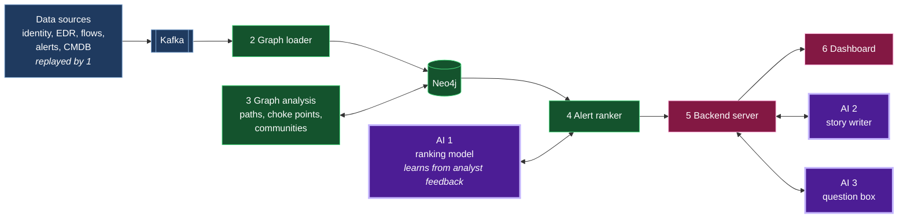

# GraphOps

Graph analytics for security operations centres (SOCs). GraphOps puts an organisation's users, machines, applications, permissions and security alerts into one Neo4j graph so analysts can see how alerts connect, what an attacker can reach next and which access paths are dangerous before an attack happens.

Built by Team Pingu Haters for hackFront India 2026 (Cybersecurity theme).

## Scope

GraphOps focuses on on-premises and hybrid networks: a company's own machines and Active Directory, plus the cloud accounts and services connected to them. Cloud-only tools already rank threats and show blast radius using graph context in the cloud. The gap we target is the company network and the attack paths that cross from it into the cloud.

## Status

**Live at [graph-ops.vercel.app](https://graph-ops.vercel.app)** (synthetic data only).

The console now has three views for an analyst on shift: **Triage** (rank and investigate today's alerts),
**Exposure** (attack paths and choke points before an attack) and **Access** (granted vs used access). The
[analyst guide](docs/analyst-guide.md) walks through them. The second build's scope and its tests (R9 to R21)
are in [PROJECT_SPEC.md](PROJECT_SPEC.md#flow-2-soc-ready-branch-featuresoc-ready-october-2026).

| Part | Status |
|---|---|
| Triage: ranked alert inbox, blast radius, linked incident, incident story, verdict | Built. First-flow requirements R1 to R8 in [PROJECT_SPEC.md](PROJECT_SPEC.md). |
| Live dashboard: alerts arrive as the day streams through Kafka, replay and reset from the top bar | Built. Polls `/api/live`; new alerts slide into the inbox and rank changes are flagged. |
| Exposure: attack paths from low-trust zones to critical assets, MITRE-tagged, with choke points and a minimum-cut remediation whose effect is recomputed exactly | Built. `GET /api/exposure`, `POST /api/exposure/simulate`. |
| Access: granted vs used access per identity, the unused-access ranking, and blast radius over granted vs used routes | Built. `GET /api/entities/{id}/access`, `/api/access/overview`, blast-radius `mode=granted\|used`. |
| Community detection (Louvain) and cross-community (lateral) incident flagging | Built. Runs on Neo4j GDS, falls back to networkx on AuraDB Free. |
| Ingest beyond Kafka: HTTP webhook, Microsoft Sentinel / Splunk ES / Elastic / Wazuh alert maps, BloodHound import | Built. See [docs/ingest.md](docs/ingest.md). |
| Analyst workflow: stable incident IDs across re-scoring, incident status and notes, benign verdicts, one-click incident report, mark-asset-critical | Built. |
| Graph view: the Neo4j engine made explicit — a live algorithm roster (Dijkstra, betweenness, PageRank, Louvain, WCC, min-cut), the one Cypher query behind each panel, and a reachability proof that times the Cypher query live next to the SQL you would need (shown, not run) | Built. `GET /api/graph/algorithms`, `/api/graph/reachability-proof`. |
| Beat-the-clock guided demo: one-click attack replay against a 29-minute breakout countdown, the kill chain lighting up step by step, ending with the time-to-connected-picture | Built. |
| Cinematic remediation: applying an Exposure fix collapses the cut attack paths and counts the risk number down to the recomputed value | Built. |
| Honest evaluation: precision@5, alerts-to-first-attack, false alarms before the first real one, average precision, GraphOps vs severity-only, plus a held-out scenario day to show it is not overfit | Built. `GET /api/evaluation`, `/api/scenarios`. |
| Streaming through Kafka, and hosting on Vercel / AuraDB Free / Aiven | Built. [docs/streaming.md](docs/streaming.md), [docs/hosting.md](docs/hosting.md). |
| Continuous integration: the backend tests and the dashboard build run on every push and pull request | Built. [.github/workflows/ci.yml](.github/workflows/ci.yml). |
| Triage screen: a filterable alert list (search, severity, verdict, graph signals) next to one alert's details in tabs (why it ranks, blast radius, incident, story) | Built. Checked at 100% zoom on 1440×900 and 1280×800 screens. |
| Incident story by Sarvam AI (`sarvam-105b`), in English or translated into 10 Indian languages with ids kept intact | Built. Tested live with Sarvam on 26 October 2026. Without a key the incident's facts are shown instead. |
| Ask tab: plain-language questions answered by Sarvam AI from eight read-only GraphOps lookups, every sentence citing its sources | Built. Tested live on 26 October 2026; the citation check removed one sentence that cited a mistyped incident id. |
| Ranking model that learns from analyst verdicts | Built, off by default. On our six synthetic days it ranked no better than the hand-set weights, so the hand-set weights stay in use. See [docs/evaluation.md](docs/evaluation.md). |
| Four harder held-out days and an evaluation report | Built. [docs/evaluation.md](docs/evaluation.md). |
| LANL evaluation | Planned, not built. |

## Current state vs. roadmap to production

GraphOps is a **working prototype, not a production deployment**. Everything in the Status table above runs today on synthetic data, and the evaluation numbers are measured, not estimated. Before a real SOC runs it on live incidents, five things stand between the prototype and production. We list them plainly, because the gap is part of an honest pitch.

| Dimension | Where it is today | What a production deployment needs |
|---|---|---|
| **Access control** | No login: anyone who can reach the port has full analyst control. | Authentication, per-analyst roles, and an audit trail of who triaged and remediated what. |
| **Real feeds** | Alert maps for Microsoft Sentinel, Splunk ES, Elastic and Wazuh, and a BloodHound import, built and unit-tested against sample payloads we wrote from public documentation. | A pilot against live SIEM and EDR feeds, where real data is messier and higher-volume than the fixtures. |
| **Scale** | Run only on the synthetic sample organisation. Precompute and query times have not been measured. | Load testing at the millions of nodes a real enterprise graph reaches, where the GDS-versus-networkx choice and precompute cost need re-measuring. |
| **Hardening** | Dev defaults: no rate limiting, no ingest size caps, a single app and database instance, CORS set to the dev origin. | Rate-limited and size-capped ingest behind the access control above, and a backup and high-availability story for Neo4j. |
| **Field validation** | Measured against labelled synthetic days, including a held-out day it was never tuned on. | A supervised pilot on real incidents to confirm the ranking holds on live attacks. |

None of these are defects; they are the normal distance between a tested prototype and a deployed product. The build is complete and honest for what a hackathon judges: a live, measured demonstration that the graph beats sorting by severity. The list above is what turns it into a tool a SOC runs on shift.

## The problem

- **Too much noise.** In the SANS 2025 Detection and Response Survey, 73% of respondents cited false positives as a main detection challenge, the most cited one, up from 64% in 2024. SANS also notes that excessive noise gives attackers cover.
- **Attackers are fast.** CrowdStrike measured an average eCrime breakout time of 29 minutes in 2025, down from 48 minutes in 2024. Breakout time is how long an attacker takes to move from the first compromised machine to others.
- **Breaches are expensive.** IBM puts the average cost of a data breach at USD 4.99 million globally and a record INR 25.5 crore in India (2026).
- **Reporting deadlines are tight.** Under the CERT-In Directions of 28 April 2022, organisations in India must report cyber incidents to CERT-In within 6 hours of noticing them.

## Pain points we tackle

| # | Pain point | What GraphOps does |
|---|---|---|
| 1 | Too many alerts, most of them false | Ranks every alert by where it sits in the graph. No alert is deleted and every rank shows its reasons. |
| 2 | Alerts arrive as separate rows | Links alerts that share a user or machine into one incident, listed by time and tagged with each alert's MITRE ATT&CK stage. |
| 3 | Attackers move faster than analysts | Precomputes each node's distance to critical assets so a new alert is scored instantly. |
| 4 | No quick answer to "how bad is this?" | Shows the 1, 2 and 3 hop blast radius around any alerted node. |
| 5 | Dangerous paths exist before any attack | Maps attack paths from low-trust zones to critical assets and lists the choke points that cut off the most paths. |
| 6 | People hold more access than they use | Draws the blast radius twice: once over granted access and once over access actually used. The difference is the risk that least privilege removes. |
| 7 | Rules check one step at a time | Adds points to an alert when a machine-to-machine logon route near it was used for the first time shortly before, even when each step looks normal. |

### AI agents as identities

Companies now run AI agents that hold real permissions. GraphOps treats every AI agent as an identity in the same graph as users, so the features above apply to it:

- **Granted vs used access:** "this agent holds 50 permissions and uses 3."
- **Never-taken path:** "this agent just reached the finance database by a route it has never used."
- **Alert ranking:** an alert on an AI agent ranks high when the agent sits close to critical assets.

IBM found that 13% of organisations reported breaches of AI models or applications and 97% of those lacked proper AI access controls (2025). BloodHound Enterprise and XM Cyber already map attack paths through AI agents. Our addition is applying granted vs used access, never-taken paths and alert ranking to them.

## How alerts are ranked

Each alert is scored on six questions answered from the graph:

1. Is it linked to other alerts through the same user or machine within a short time?
2. How many steps is it from a critical asset?
3. How many critical assets sit within 3 hops of it?
4. Is it unusual, such as a first-time action or a never-used path?
5. Do the linked alerts follow attack stages in order?
6. Does it sit on a choke point?

The weight of each question is our design choice, set by hand in `backend/app/scoring.py`. We plan to tune them on test data and later learn them from analyst verdicts.

## Where AI is used

| Part | What it does | Tools | How we keep it honest | Status |
|---|---|---|---|---|
| 1. Ranking model | Learns how much each ranking question should count, from analysts marking alerts real, benign or false | Logistic regression written in plain Python (`backend/app/learn.py`), because the hosted site cannot install numpy or scikit-learn | Small and explainable: its weights are shown next to the hand-set ones on the Evaluation tab. It is not switched on automatically. | Built, off by default. No better than the hand-set weights on our synthetic days. |
| 2. Incident story | Drafts a plain-English story of an incident from its alerts, users, machines and connections, then optionally translates it | Sarvam AI `sarvam-105b` for the story and `sarvam-translate:v1` for Indian languages, called over HTTPS with Python's standard library. Claude is a fallback when no Sarvam key is set. | Every sentence must cite ids from the incident; a checker drops any sentence that cites an id outside it, and the story is marked as needing analyst approval. Each connection is given to the model in plain words so it does not misread its direction. Ids are protected during translation. | Built. Tested live with Sarvam. |
| 3. Ask tab | Answers questions such as "what can the intern's laptop reach?" in plain words | Sarvam AI `sarvam-105b` with tool calling over eight fixed lookups: top alerts, one alert, blast radius, an incident, attack paths, the access gap, ranking quality and entity search | The model can only read through those lookups; it cannot write or run free-form queries. Every sentence must cite ids the lookups returned, and other sentences are removed. The answer lists which lookups were used. | Built. Tested live with Sarvam. |

The AI checks confirm that a sentence cites the right facts, not that its wording describes them correctly. Every AI answer is labelled as needing an analyst's check.

## How GraphOps differs from existing tools

Existing products each cover part of this list. In our review of Microsoft, Google SecOps, Palo Alto Cortex, Splunk Enterprise Security, CrowdStrike, BloodHound, Wiz and XM Cyber, none covered all seven pain points. None documented points 6 and 7 for on-premises networks.

GraphOps is not a new algorithm. It brings these capabilities into one open, self-hosted Neo4j graph that takes data from any vendor.

## How it works

GraphOps is six programs arranged in layers. Steps 1 to 3 handle data and graph maths. AI is used in steps 4 and 5. This section describes the full design. Parts not built yet are marked *(planned)*; the [Status](#status) table has the summary.



Blue: data and streaming. Green: graph and ranking. Purple: AI. Pink: server and dashboard.

### 1. Live data simulator

We have no real company sending us live security data, so this Python script plays back saved data as if it were happening now.

- It reads saved events in time order, for example "10:42:03, raja logged into server-7".
- It waits the real gap between events, or a shorter gap: at the default 60x the sample day of about 4 hours plays in about 4 minutes.
- It mixes random everyday activity, such as normal logins, programs starting and file share traffic, in with the day's saved noise alerts, so the attack is not the only activity in the stream. It never creates a new route or a remote logon.
- It injects the scripted attack only when asked, so we can show the inbox before and after the attack.
- It sends each event to Kafka, into a topic for its source: logins and permissions to `identity`, programs started to `edr`, network connections to `flows`, security alerts to `alerts` and machine inventory to `cmdb`.

In a real company, the security tools themselves would send events to Kafka and this script would not be needed. The message formats for each topic are in [docs/streaming.md](docs/streaming.md).

### 2. Graph loader

This Python program listens to the five Kafka topics and turns each event into dots and lines in Neo4j.

- "raja logged into server-7" becomes a `LoggedInto` edge from the user `raja` to the machine `server-7`.
- If the edge already exists, it updates "last seen". If it is new, it records "first seen". This is how GraphOps later knows a path has never been used before.
- Every event has an ID. The loader skips IDs it has already seen and creates the rest, with a uniqueness rule on the ID as a backstop, so a message read twice changes nothing.
- It saves how far it has read in each topic in Neo4j, in the same transaction as the events, so a crash never loses or repeats an event.
- On a laptop it runs all the time. On the hosted site, where functions stop after a few minutes, the same code runs each time the dashboard asks for new alerts.
- When the event is an alert, it saves the alert as a node linked to the user and machine involved, then tells the alert ranker a new alert has arrived.

### 3. Background graph analysis

This Python code does the slow calculations ahead of time, so nothing slow happens while an analyst waits. It runs when the data is loaded and again whenever the network itself changes, such as a new login route or a new critical asset. It does not rerun for every alert.

- It counts how many steps each machine and account is from the nearest critical asset, such as the customer database, and saves that number on the node.
- It finds choke points and saves a choke point score on each node.
- *(planned)* It groups machines that normally work together into communities and saves the group number on each node.

### 4. Alert ranker (uses AI 1, planned)

This Python program scores each new alert the moment it arrives.

1. It answers the six ranking questions. Most answers are already saved on the nodes by step 3, so this takes milliseconds. For example: "server-7 is 2 steps from the customer database" and "server-7 is a choke point".
2. It combines the answers into one score with hand-set weights. A small logistic regression can learn weights from analysts marking alerts real, benign or false; it is shown on the Evaluation tab but not switched on.
3. It links alerts that share a user or machine within 2 hours, or that are joined by a login from one alert's machine to the next within 45 minutes, into one incident.
4. It saves the score, the reasons and the incident in Neo4j and passes the ranked alert on to the backend server.

### 5. Backend server (hosts AI 2 and AI 3)

A FastAPI web server that sits between the dashboard and the data.

- It answers the dashboard's questions, such as "what is the blast radius of laptop-42?" or "show the attack paths to the customer database", by running Cypher queries on Neo4j.
- It serves new and changed alerts at `/api/live`. During a replay the dashboard asks it every 2 seconds, so new alerts appear without a page refresh. This also works on Vercel, where long-lived connections are limited.
- It hosts the two LLM features:

**Incident story writer.** When the analyst asks for an incident's story:
1. A Cypher query pulls every alert, machine, account and connection in the incident, each with its ID.
2. These facts go to Sarvam AI with one rule: every sentence must cite the ID it is based on.
3. A checker drops any sentence that cites an ID not in the incident, so the LLM cannot invent facts.
4. The analyst sees the draft marked "needs analyst approval".

**Ask tab.** When the analyst types "what can the intern's laptop reach?":
1. Sarvam AI chooses from eight read-only lookups, for example an entity search for "intern" and then the blast radius of `laptop-42`.
2. GraphOps runs those lookups itself and hands back the results.
3. Sarvam writes the answer as sentences, each citing the ids it is based on. Sentences citing anything the lookups did not return are removed.
4. The answer shows which lookups were used, and can be translated into 10 Indian languages.

### 6. Dashboard

The React web app the analyst uses. The blast radius is drawn as rings in SVG.

- **Alert inbox:** every alert, highest score first, with the reasons for its rank.
- **Blast radius rings:** click an alert to see everything 1, 2 and 3 steps away, with the shortest attack path to a critical asset.
- **Incident view:** linked alerts in attack-stage order with the drafted story.
- **Access comparison:** the blast radius over granted access next to the blast radius over used access, and the Access tab's least-privilege gap.

## Tech stack

### What we use today

| Layer | Tool | Why we chose it |
|---|---|---|
| Streaming | Apache Kafka 4.3: the official `apache/kafka` image in KRaft mode (no ZooKeeper) on a laptop, Aiven for Apache Kafka free plan when hosted | One topic per data source, so a new source plugs in without changing anything else. Replaying a topic lets us feed recorded data as if it were live. Aiven's free plan is real Kafka with no card needed and allows exactly the 5 topics we use. |
| Data simulator | Python, our own script (`app/simulate.py`) | Plays one day at the sample organisation into Kafka at any speed, with a fixed random seed so every run is the same. |
| Ingest and scoring | Python 3.12 with `confluent-kafka` 2.16 and the official Neo4j driver | We score each alert the moment it arrives. A plain connector only copies data and cannot do that. `confluent-kafka` ships a ready-built Linux package, so it installs on Vercel with nothing to compile. |
| Graph database | Neo4j 2026.09: Community with Graph Data Science and APOC on a laptop, AuraDB Free when hosted | Free. Shortest paths and betweenness come built in. AuraDB Free has no Graph Data Science, so there the choke point scores are worked out in Python with `networkx` instead. |
| API | FastAPI | Same language as the rest of the backend. Runs on Vercel as a single function with no changes. |
| Dashboard | React 19 built with Vite, with the blast radius drawn as our own SVG ring graph | Full control over the ring layout with no extra library. We first chose Neo4j's NVL, but its licence only allows use with Neo4j Aura or Neo4j's commercial products, not Neo4j Community. |
| Incident story and Ask tab | Sarvam AI: `sarvam-105b` (chat with tool calling and strict JSON output) and `sarvam-translate:v1` | Sarvam is the hackathon's AI partner and builds for Indian languages. Strict JSON lets our checker read which ids each sentence cites. Called with Python's standard library, so nothing extra installs on Vercel. Claude through the `anthropic` SDK is a fallback for the story. |
| Ranking model | Logistic regression in plain Python | Explainable, trains in a moment on a few verdicts, and needs no numpy, which the hosted site cannot install. |
| Hosting | Vercel Hobby plan, functions in Singapore (`sin1`) | Every push to `main` redeploys. Singapore puts the backend next to the database, which made each database query 50 to 100 times faster than Vercel's default, Washington DC. |
| Running it locally | Docker Desktop with Docker Compose | Neo4j and Kafka start with one command. |
| Testing | pytest with Testcontainers | Tests start a real Neo4j and a real Kafka in Docker for each run, so they never touch real data. |

### Considered for the Ask tab and not used

| Tool | Why not |
|---|---|
| `neo4j-graphrag` `Text2CypherRetriever` | It turns a question into a new Cypher query, which Neo4j says "is not guaranteed to be syntactically correct". Fixed read-only lookups chosen by the model are safer and easier to check. |

### Tools we considered and left out

| Tool | Why not |
|---|---|
| Apache Spark | Our data fits on one machine. Spark adds setup without adding value at this size. |
| Kubernetes | Docker Compose is enough to run and deploy the prototype. |
| PyTorch Geometric (graph neural networks) | Recent studies re-tested graph neural network detectors fairly and their precision collapsed. Simple, explainable rules hold up better. See [docs/research.md](docs/research.md). |

## Data

| Source | What it gives us | Real or synthetic |
|---|---|---|
| ADSynth | A realistic company network: users, groups, computers and permissions in Active Directory and the cloud | Synthetic |
| LANL 2015 (Los Alamos National Laboratory) | 58 days of authentication events and network flows from a real network, with one controlled red-team exercise | Real background activity, anonymised; the attack is a controlled exercise. Not loaded yet. |
| Scripted attack scenario | A known attack replayed as live events and alerts | Synthetic |

The console always states that its data is synthetic.

## How we test it

| Test | What it proves |
|---|---|
| Known-answer graphs | On a small hand-made graph, attack paths, choke points and the minimum cut come out exactly right. Blast radius is checked on the sample organisation. |
| Held-out scenarios | Five attack days the weights were never tuned on, each built around a known weakness, compared with sorting by severity. Results and limits in [docs/evaluation.md](docs/evaluation.md). |
| Detection on a red-team exercise (planned) | On the LANL data we will measure precision, missed attacks and alerts per day against the red-team labels. We do not report AUC on its own. |
| Attack replay | A scripted attack streamed through Kafka ends up as one incident, ranked near the top, the same as loading it in one batch. |
| Speed | We send one alert straight to Kafka and check it shows in `/api/live` within 5 seconds. On the hosted site we timed a whole replayed day once (see [docs/hosting.md](docs/hosting.md)). |
| Break tests | Empty events, very large events and malformed events are rejected without crashing the pipeline. |
| AI checks | Incident stories that cite a node outside the incident are rejected. Planned: generated queries that try to write are refused, and a ranking model is compared against hand-set weights. |
| People test (planned) | People who have not seen GraphOps answer "what happened?" first from a raw alert list and then with GraphOps. We time both. |
| Continuous checks | GitHub Actions runs the backend tests (real Neo4j and Kafka in Docker via Testcontainers) and the dashboard build on every push and pull request. See [.github/workflows/ci.yml](.github/workflows/ci.yml). |

## Run it

### Everything in one command

With Docker Desktop running:

```bash
cp .env.example .env                          # choose a local password
docker compose --profile app up --build       # Neo4j + Kafka + the app, seeded
# open http://localhost:8000
```

This builds the dashboard, seeds the sample organisation and serves the console and API on port 8000. The
`app` profile is opt-in, so the plain `docker compose up -d` below still starts only the infrastructure when
you want to run the backend and dashboard yourself.

### For development

You need Docker Desktop, Python 3.12 or newer and Node.js 20.19 or newer (on version 22, 22.12 or newer).

```bash
# 1. settings: copy the example and choose a local password
cp .env.example .env

# 2. start Neo4j with Graph Data Science and APOC, and Kafka
docker compose up -d

# 3. backend: install, seed the sample data, start the server on port 8000
cd backend
python3 -m venv .venv
.venv/bin/pip install -r requirements.txt
.venv/bin/python -m app.seed
.venv/bin/uvicorn app.main:app --port 8000

# 4. dashboard, in a second terminal: open http://localhost:5173
cd frontend
npm install
npm run dev
```

**AI incident stories** use Claude through the Anthropic SDK. Log in once with `ant auth login` (Anthropic's command-line tool). No API key is stored in the project. The account needs API credit. Without access, the dashboard shows the incident's facts instead of a story.

**Live replay** plays the sample day through Kafka instead of loading it in one batch. With the backend running and `KAFKA_BOOTSTRAP=localhost:9092` in `.env`:

```bash
curl -X POST localhost:8000/api/replay/reset        # network only, no alerts yet
curl -X POST localhost:8000/api/replay/start \
     -H 'content-type: application/json' -d '{"attack": true, "speed": 60}'
curl 'localhost:8000/api/live?since=0'              # call again to see new alerts as they are scored
```

The same day can be sent from a terminal with `.venv/bin/python -m app.simulate --attack`, and `.venv/bin/python -m app.stream` reads Kafka continuously without the server. Without `KAFKA_BOOTSTRAP`, the replay writes straight into Neo4j. To go back to the batch data, run `.venv/bin/python -m app.seed` again.

**Tests** start their own Neo4j and Kafka in Docker, so they never touch your data:

```bash
cd backend
.venv/bin/python -m pytest
```

## Team

Team Pingu Haters: Deepthi Sree Dubasi, Vatanesh Sharma, Bhanu Sai Teja, Raja Mohamad and SK MD Mahasin.

## Disclosure

As the hackFront India rules require, we list every AI tool, service, framework and dataset used in this project. This list is updated as we go and will be checked again before submission.

- **AI tools used to build it:** Claude Code (Anthropic) wrote and reviewed code, documents and research with us. Every claim we use was checked at its original source.
- **AI inside the product:** Sarvam AI (`sarvam-105b` and `sarvam-translate:v1`) drafts incident stories, answers questions in the Ask tab and translates both into Indian languages. Claude through the Anthropic API is a fallback for the story when no Sarvam key is set.
- **Hosted services (free plans and credits):** Vercel (hosting), Neo4j AuraDB Free (database), Aiven for Apache Kafka (streaming), Sarvam AI (language models, signup credits).
- **Open source:** Neo4j Community, Graph Data Science, APOC, Apache Kafka, Python, FastAPI, Uvicorn, `confluent-kafka`, the Neo4j Python driver, `networkx`, `python-dotenv`, `certifi`, React, Vite, pytest, Testcontainers, Docker.
- **Data:** all data in the repository and on the hosted site is synthetic, made up by us. Datasets planned for evaluation (ADSynth, LANL) are listed under [Data](#data).

## Sources

- SANS Institute, *SANS 2025 Detection and Response Survey*, Josh Lemon, December 2025.
- CrowdStrike, [2026 Global Threat Report press release](https://www.crowdstrike.com/en-us/press-releases/2026-crowdstrike-global-threat-report/) and [2025 Global Threat Report press release](https://www.crowdstrike.com/en-us/press-releases/crowdstrike-releases-2025-global-threat-report/).
- IBM, [Cost of a Data Breach 2026 release](https://newsroom.ibm.com/2026-07-29-ibm-study-one-in-four-malicious-breaches-are-ai-enabled,-costing-companies-6-million-on-average) and [IBM India 2026 release](https://in.newsroom.ibm.com/India-Records-its-Highest-Average-Cost-of-a-Data-Breach-2026).
- CERT-In, [Directions under Section 70B of the IT Act, 28 April 2022](https://www.cert-in.org.in/PDF/CERT-In_Directions_70B_28.04.2022.pdf).
- Neo4j, [neo4j-graphrag Python documentation](https://neo4j.com/docs/neo4j-graphrag-python/current/).
