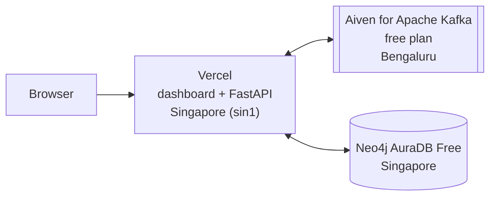

# Hosting

How the live site at [graph-ops.vercel.app](https://graph-ops.vercel.app) is set up. Everything runs on free plans. All data on it is synthetic.

## The three services



| Service | Plan | Where it runs | What it does for us |
|---|---|---|---|
| [Vercel](https://vercel.com) | Hobby (free) | Functions in Singapore (`sin1`) | Builds and serves the React dashboard and runs the FastAPI backend as one Python function. Every push to `main` on GitHub redeploys. |
| [Neo4j AuraDB](https://neo4j.com/cloud/aura-free/) | AuraDB Free | Singapore, on Google Cloud | The graph database: users, machines, permissions, alerts and incidents. |
| [Aiven for Apache Kafka](https://aiven.io/free-kafka) | Free plan, no card needed | Bengaluru, on DigitalOcean | Five topics (`identity`, `edr`, `flows`, `alerts`, `cmdb`), two partitions each. The live replay goes through it. |

How we know where each runs: Vercel's `x-vercel-id` response header shows the function region. For AuraDB and Aiven we looked up the server address with IP lookup sites, so those two locations are very likely right but not official.

## Settings on Vercel

**Build.** Set in `pyproject.toml`: the backend entry point is `backend.app.main:app`, and the build step runs `npm ci && npm run build` in `frontend`. Vercel installs the Python packages listed in `pyproject.toml` with Python 3.12. FastAPI serves the built dashboard from `frontend/dist`.

**Environment variables.** Set in the Vercel project under Settings, Environment Variables, for Production. The values are never in the repository.

| Name | What it is | Type |
|---|---|---|
| `NEO4J_URI` | AuraDB connection address (`neo4j+s://...`) | Config |
| `NEO4J_USERNAME` (or `NEO4J_USER`) | AuraDB user. The app accepts either name. | Config |
| `NEO4J_PASSWORD` | AuraDB password | Secret |
| `KAFKA_BOOTSTRAP` | Aiven Kafka host and port | Config |
| `KAFKA_USERNAME` | Aiven Kafka user | Config |
| `KAFKA_PASSWORD` | Aiven Kafka password | Secret |
| `KAFKA_CA_PEM` | Aiven's CA certificate, the whole text. It lets the app check it is really talking to Aiven. It is public, not a password. | Config |

Aiven signs clients in with a username and password (SASL, SCRAM-SHA-256) over TLS. This works on the free plan: we checked by connecting, creating the five topics and sending and reading back a test message on 13 October 2026.

Without the `KAFKA_*` variables the site still works: the live replay then writes straight into Neo4j instead of going through Kafka.

**Function region.** Settings, Functions, Function Region: Singapore (`sin1`) only. The Hobby plan allows one region. A new deployment is needed after changing it.

## Why Singapore

New Vercel projects run their functions in Washington DC (`iad1`) by default. Our database is in Singapore, so every query crossed the world and took about a quarter of a second. Moving the functions to Singapore was the biggest single speed-up.

Measured on the live site on 13 October 2026, replaying the sample day (201 events, 30 alerts) at 5,000 times real speed:

| Step | Washington, one query per event | Singapore, queries in batches |
|---|---|---|
| Reset to the network only | 39.5 s | 4.5 s |
| Send the day into Kafka | 7.2 s | 3.9 s |
| Read from Kafka, save to Neo4j and rank all 30 alerts | about 145 s | **2.4 s** |

Both changes were needed. Batching cut a full replay from 629 database queries to 59. Moving to Singapore made each remaining query much faster. The first column includes a cold start of the function, so it is not a perfectly fair comparison.

## Limits to know

- **Aiven powers off an idle free service.** Its docs do not say after how long. Before a demo, check the service is running in the Aiven console and start it if not. Topic data is lost when it powers off, which does not matter to us because every event ends up in Neo4j.
- **AuraDB Free pauses after a few days without use and deletes a database left unused for 30 days.** A paused database has to be resumed from the Neo4j console. A daily GitHub Action (`.github/workflows/keep-alive.yml`) queries the site to prevent both. Check it before a demo too.
- **Vercel Hobby functions stop after 300 seconds.** A replay at the default 60x takes about 4 minutes, close to that limit. For demos use a higher speed.
- **Replaying wipes the hosted alerts** and refills them. Anyone looking at the site during a replay sees a partly filled inbox.

## Running a replay on the live site

```bash
curl -X POST https://graph-ops.vercel.app/api/replay/reset
curl -X POST https://graph-ops.vercel.app/api/replay/start \
     -H 'content-type: application/json' -d '{"attack": true, "speed": 5000}'
curl 'https://graph-ops.vercel.app/api/live?since=0'
```
