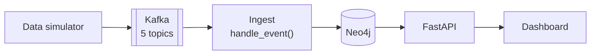

# Live data: simulator and streaming

Status, 13 October 2026:

- **Built and tested on a laptop:** the simulator, Kafka in Docker, the ingest with saved read positions, re-scoring as alerts land and the `/api/replay/*` and `/api/live` endpoints. All five tests in the table at the end pass against a real Kafka (`backend/tests/test_streaming.py`).
- **Not built yet:** the dashboard asking `/api/live` every 2 seconds and the replay buttons, and the hosted site connected to Aiven. Until Aiven is connected, the hosted site's replay writes straight into Neo4j.

The first flow still loads one saved day in a single batch (`python -m app.seed`).

## Why we need it

The problem statement asks us to "calculate blast radius in real time: when a compromise indicator fires on a node" and to "continuously map" attack paths. Today nothing fires on its own. Every alert is already in the database when the dashboard opens. The live pipeline fixes that: events arrive one by one, each alert is scored the moment it lands and the dashboard shows it within a few seconds.

The problem statement lists Apache Kafka as a suggested tool for streaming telemetry. It is optional, but it is the standard tool for this job, so we keep it.

## The shape of it



The same Python code runs in both places. Only the way it is triggered changes.

| | On a laptop | On the hosted site |
|---|---|---|
| Kafka | Apache Kafka in Docker (official `apache/kafka` image) | Aiven for Apache Kafka, free plan |
| Neo4j | Neo4j in Docker with Graph Data Science and APOC | Neo4j AuraDB Free |
| Simulator | `python -m app.simulate` in a terminal | "Start replay" button, or the same command on a laptop pointed at Aiven |
| Ingest | A long-running consumer that reads Kafka all the time | Runs inside `GET /api/live`: each call reads whatever is new in Kafka, writes it to Neo4j and returns new alerts |
| Dashboard updates | Asks `/api/live` every 2 seconds | Same |

The code: `backend/app/simulate.py` (the simulator), `backend/app/events.py` (checks each message and writes it to the graph once), `backend/app/stream.py` (reads Kafka, saves read positions, re-scores) and the endpoints at the end of `backend/app/main.py`.

## Why Aiven for the hosted version

Vercel runs our backend as short-lived functions. On the Hobby plan a function can run for at most 300 seconds, so nothing can sit there reading Kafka all day. We need a Kafka we can reach over the internet for free, and a way to read it in short bursts.

| Option | What we found | Decision |
|---|---|---|
| Aiven for Apache Kafka, free plan | Real Apache Kafka. "No credit card needed." Up to 5 topics with 2 partitions each, up to 250 kb/s in and out, data kept up to 3 days. Powers off when nothing is produced or consumed; topic data is lost on shutdown, configuration is kept. Kafka Connect is not included. | **Use it.** Same Kafka as the laptop version, and exactly 5 topics is what we need. Losing topic data on shutdown does not matter because every event ends up in Neo4j. |
| Vercel Queues | Public beta, "available on all plans", Python SDK, push or poll consumers. | Not chosen. It only exists on Vercel, so the laptop version would need different code, and it is not Kafka. |
| Upstash Redis | Free tier: 250 MB and 500K commands a month. | Fallback only. It is a key-value store with streams, not a message broker. |
| No broker at all | The replay endpoint writes straight into Neo4j. | Kept as the emergency fallback. Simplest, but it hides the pipeline judges asked about. |

Sources: [Aiven free Kafka](https://aiven.io/free-kafka), [Aiven free tier docs](https://aiven.io/docs/products/kafka/free-tier/kafka-free-tier), [Vercel function limits](https://vercel.com/docs/functions/limitations), [Vercel Queues](https://vercel.com/docs/queues), [Upstash Redis pricing](https://upstash.com/docs/redis/overall/pricing). Checked 12 October 2026.

What we checked on 13 October 2026:

| Question | Answer | Evidence |
|---|---|---|
| How long Aiven waits before powering off an idle free service | Not published. The docs say only that it powers off when nothing is produced or consumed, sends a notice first, and that a new service with no use "can power off within the first few hours". We should expect to power it on from the Aiven Console before a demo. | [Aiven free tier docs](https://aiven.io/docs/products/kafka/free-tier/kafka-free-tier) |
| How clients sign in | Paid Aiven Kafka uses client certificates, and a username and password (SASL, PLAIN or SCRAM) can be switched on in the service settings. The free tier page says standard clients connect "the same way" as on paid plans, but does not say SASL can be switched on there. Our code supports username and password with Aiven's certificate authority. To confirm when we create the service. | [Aiven SASL docs](https://aiven.io/docs/products/kafka/howto/kafka-sasl-auth) |
| Whether the Kafka client installs on Vercel | Likely yes: `confluent-kafka` 2.16 ships a ready-built Linux wheel with its C library inside, so nothing has to compile. Not yet tried on Vercel itself. | The wheel `confluent_kafka-2.16.0-cp312-cp312-manylinux_2_28_x86_64.whl` downloaded from PyPI |

## Reading Kafka from short-lived functions

Two choices make this safe when many short calls read the same topics.

- **We track our own read position.** Normally Kafka consumers join a "consumer group" and Kafka remembers how far each one has read. Joining a group takes a few seconds each time, which is too slow for a call every 2 seconds. Instead we read each partition directly and save the position (the offset) in Neo4j, in the same transaction as the events we just wrote. If the call crashes halfway, neither the events nor the new position are saved, and the next call picks up from the same place.
- **Every event has an ID and is written with `MERGE` on that ID.** If two people have the dashboard open and both calls read the same message, the second write changes nothing. No event is counted twice.

## The data simulator

We have no real company sending us security data, so the simulator plays one day at the sample organisation as if it were happening now.

- **Baseline day.** It replays the saved events and alerts from `data/sample_org/` in time order.
- **Everyday activity.** It adds 150 random normal events between the day's saved noise alerts: users logging into their own laptops, programs starting and traffic to the file server. It only repeats routes already seen before the day, so it never creates a new path, and it never sends remote logons, because the ranker reads their timing. This makes the stream look like a real network instead of a script.
- **The attack on command.** The scripted attack (phishing, credential dumping, remote logon, pass-the-hash) is injected only when asked, with `--attack` or the dashboard button. This lets us show the inbox before and after the attack.
- **Speed.** The sample day covers about 4 hours (08:05 to 11:55). At the default 60x it plays in about 4 minutes, which fits inside one Vercel function call. `--speed 1` plays in real time, `--speed 600` in under half a minute.
- **Repeatable.** A fixed random seed gives the same stream every time, so tests can check exact results.
- **Topic per source.** Each event goes to the topic for the tool that would really produce it. The message key is the machine or account the event is about, so events about one machine stay in order.

## What the data looks like

Every message is one JSON object. All of them share these fields:

| Field | Meaning |
|---|---|
| `event_id` | Unique ID, used to ignore duplicates |
| `time` | When it happened, in the simulated day |
| `source_tool` | The tool that would have produced it |
| `kind` | What happened |

### `identity`: logins and permission changes

```json
{"event_id": "id-000412", "time": "2026-10-20T10:20:00", "source_tool": "Active Directory",
 "kind": "RemoteLogon", "src": "laptop-42", "dst": "server-7", "user": "it_admin"}
```

```json
{"event_id": "id-000415", "time": "2026-10-20T10:24:00", "source_tool": "Active Directory",
 "kind": "MemberOf", "src": "contractor_2", "dst": "g_it_admins", "change": "added"}
```

In the graph: a logon creates or updates a `RemoteLogon` or `LoggedInto` edge with `first_seen`, `last_seen` and `count`. A permission change adds or removes a granted edge.

### `edr`: programs started on machines

```json
{"event_id": "edr-001207", "time": "2026-10-20T10:11:40", "source_tool": "EDR",
 "kind": "ProcessStart", "host": "laptop-42", "user": "intern_a",
 "process": "rundll32.exe", "parent": "outlook.exe"}
```

In the graph: kept as activity on the machine. The EDR raises an alert separately when it judges a process to be malicious.

### `flows`: network connections

```json
{"event_id": "fl-004532", "time": "2026-10-20T10:30:12", "source_tool": "Firewall",
 "kind": "Connection", "src": "server-7", "dst": "customer-db", "dst_port": 1433, "bytes": 18320}
```

In the graph: creates or updates a `ConnectedTo` edge with `first_seen`, `last_seen` and `count`.

### `alerts`: security alerts

```json
{"event_id": "al-a-03", "time": "2026-10-20T10:20:00", "source_tool": "SIEM",
 "kind": "Alert", "id": "a-03", "name": "Remote logon from an unusual host", "severity": "low",
 "tactic_id": "TA0008", "technique_id": "T1021", "involves": ["it_admin", "server-7"]}
```

In the graph: an `Alert` node linked to every user and machine it involves. This is the event that triggers scoring: the alert gets its score and reasons, is linked into an incident and appears in the dashboard.

### `cmdb`: machine inventory

```json
{"event_id": "cm-000031", "time": "2026-10-20T08:00:00", "source_tool": "CMDB",
 "kind": "Asset", "id": "server-7", "label": "Computer", "os": "Windows Server 2022",
 "zone": "server", "owner": "it_admin", "critical": false}
```

In the graph: creates or updates the machine node. Marking an asset critical makes the background analysis recompute distances to critical assets.

## What happens when an alert arrives

1. The ingest code writes the alert and links it to the users and machines involved.
2. It re-runs the scoring for the alerts of that day. With tens of alerts this takes milliseconds, so the existing `score_all` is reused as it is.
3. The distances to critical assets and the choke point scores are recomputed only when the network itself changes (a new edge, a permission change or a new critical asset), not on every alert.
4. `GET /api/live` returns the alerts that are new or whose score changed, and the dashboard slides them into the inbox.

## New endpoints

| Endpoint | What it does |
|---|---|
| `POST /api/replay/start` | Starts the simulator. Body: `{"attack": true, "speed": 60}`. On a laptop it runs in the background. On Vercel it runs inside the request, because a function is frozen once it has answered. |
| `POST /api/replay/reset` | Wipes the stream state and reseeds the baseline graph |
| `GET /api/live?since=<cursor>` | Reads new events, updates the graph and returns what changed |

## How we test it

All pass, run with `.venv/bin/python -m pytest tests/test_streaming.py`.

| Test | Pass when |
|---|---|
| Attack replay | The scripted attack streamed through Kafka ends up as one incident, with its alerts in the top 5, matching the batch result. |
| Duplicates | Sending every message twice gives the same graph and the same scores. |
| Crash halfway | Killing ingest mid-batch and restarting loses no event and counts none twice. |
| Speed | Time from an alert being sent to it showing in `/api/live` is under 5 seconds at 60x. |
| Bad messages | Empty, oversized and malformed messages are skipped and logged without stopping the stream. |
| No broker | Replaying straight into Neo4j without Kafka gives the same result as the batch load. |

We also ran the whole thing by hand on a laptop at 600x speed: the day's 201 messages played in about 25 seconds, the attack alerts appeared in `/api/live` about 15 seconds in, and the final inbox had all four attack alerts in the top five, as in the batch load.
